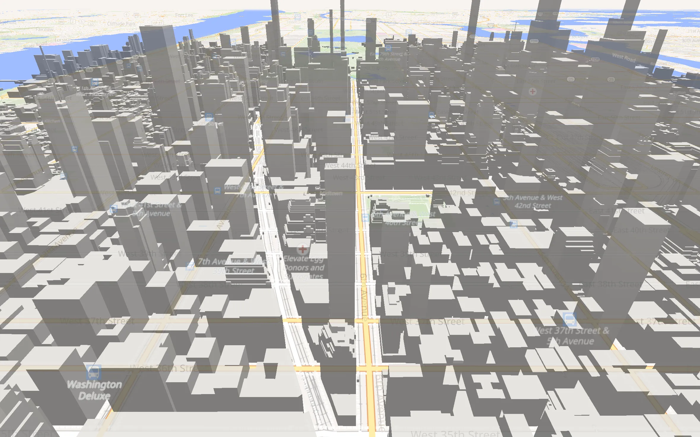
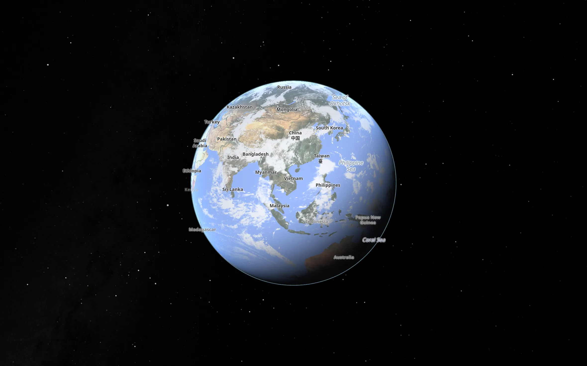
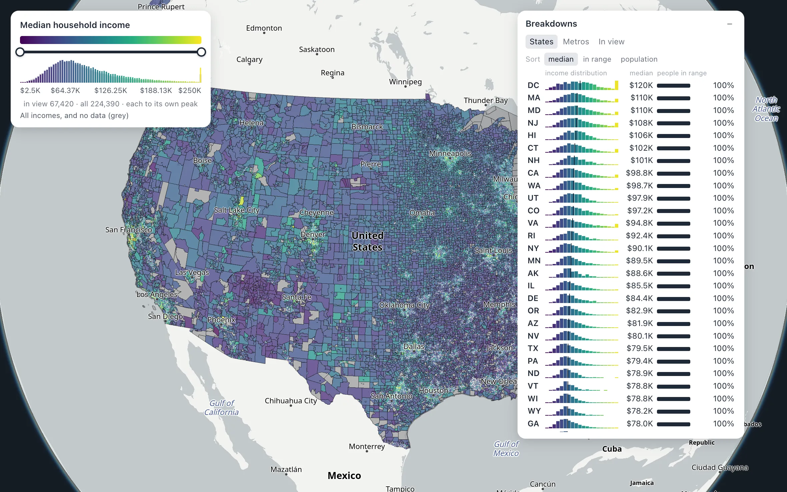
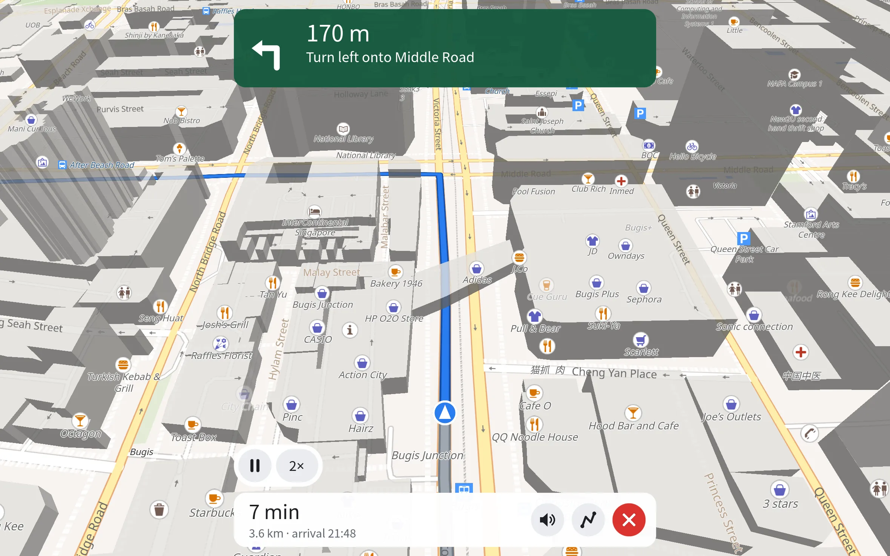
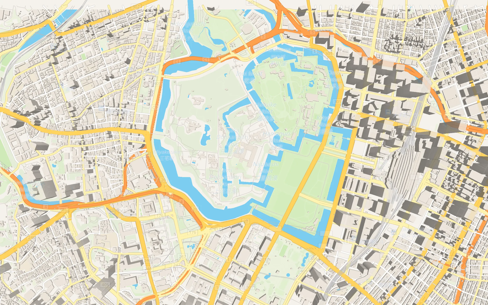
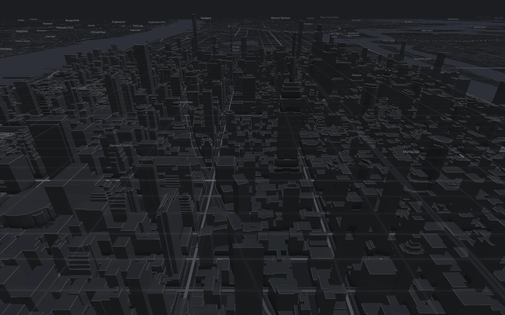
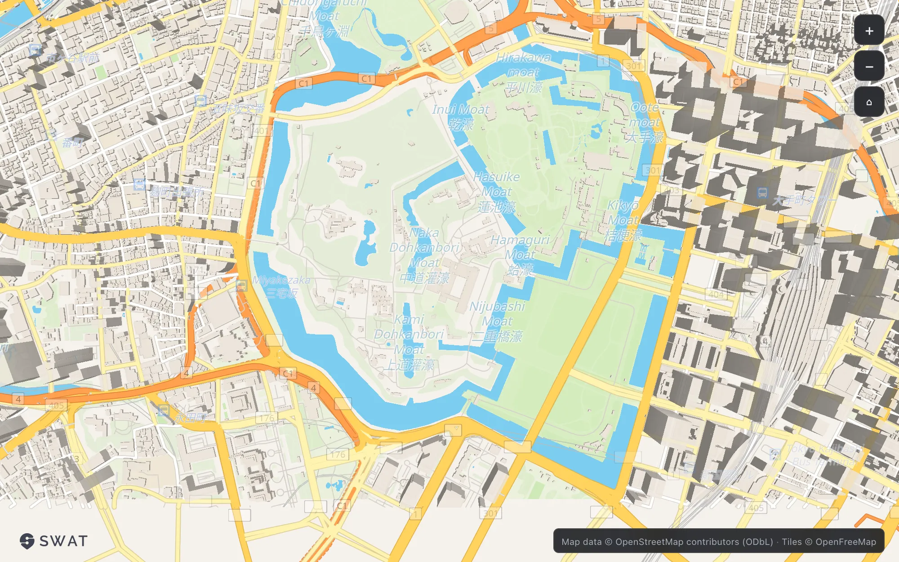

<!--
This file becomes the repository's root README.md at the cut
(scripts/split-lib-transform.py moves it), so every link below is relative
to the repository root, not to docs/public/.
-->

# SWAT Maps for GPUI

**`gpui-maps`** is a native, GPU-rendered vector-map engine for
[GPUI](https://www.gpui.rs), the UI framework of the Zed editor, written in
Rust on `wgpu`. A map is a GPUI view: add it to any window. No web view, no JavaScript runtime, no account
or token needed for the default maps.

<p align="center">
  
</p>

<table>
  <tr>
    <td width="33%"><br><sub><b>Globe</b> that blends into flat Mercator</sub></td>
    <td width="33%"><br><sub><b>Data</b>: 224,390 US census block groups, filtered live</sub></td>
    <td width="33%"><br><sub><b>Navigation</b>: turn-by-turn route following</sub></td>
  </tr>
  <tr>
    <td width="33%"><br><sub><b>Styles</b>: six keyless basemaps, MapLibre style JSON</sub></td>
    <td width="33%"><br><sub><b>3D</b>: <code>fill-extrusion</code> buildings, any style</sub></td>
    <td width="33%"><br><sub><b>Web</b>: the same engine in a browser (wasm)</sub></td>
  </tr>
</table>

Try it live in a browser: [gpui-maps.swatmobility.com](https://gpui-maps.swatmobility.com).

- **Tiles:** Mapbox Vector Tiles (MVT) over HTTP, local or remote
  [PMTiles](https://github.com/protomaps/PMTiles) archives, MBTiles files,
  and raster tiles.
- **Styling:** MapLibre / Mapbox GL style JSON (style spec v8), with
  expressions, compiled by the engine. Six keyless basemaps over
  OpenFreeMap ship embedded in the crate.
- **Globe:** a globe projection at low zoom that blends into flat Mercator,
  with an atmosphere and sky; tilt and rotate.
- **3D:** `fill-extrusion` buildings, overlay extrusion, and glTF models
  (feature `models`).
- **Data overlays:** GeoJSON sources with per-feature paint, clustering,
  hover and click picking; CSV, FlatGeobuf, GeoParquet and Cloud-Optimised
  GeoTIFF readers; origin-destination arcs, animated trips, heatmaps,
  hexagon and grid binning, dot density, vector-tile overlays.
- **Navigation:** turn-by-turn route following on
  [Ferrostar](https://github.com/stadiamaps/ferrostar)'s Rust core, with
  engine-drawn route line, puck and manoeuvre text.
- **Offline:** render from a local `.pmtiles` file with the network denied.
- **Headless capture:** render a camera, or a scripted map story, to PNG or
  video without a window.
- **Other shells:** the same engine source drives an iOS shell (`ios/`,
  UIKit + Metal), a Swift embedding (`embed-ios/`), and a browser build
  (`web/`, wasm on WebGPU with a WebGL2 fallback).

This is an early-stage project, version 0.x: expect API changes between
minor versions (`docs/versioning.md` explains the policy, and
`CHANGELOG.md` records each release).

## Quick start

On a Mac with the Rust toolchain installed:

```bash
git clone https://github.com/swatmobility/gpui-maps
cd gpui-maps
cargo run --example hello_map
```

`examples/hello_map.rs` opens a window on Singapore with OpenFreeMap's
Liberty style, using the default features only. The core of it:

```rust
use gpui_maps::basemaps::{self, Basemap};
use gpui_maps::map_view::MapView;

let b = basemaps::load(Basemap::Liberty)?; // style + tile source + sprite URL
let map = cx.new(|_| MapView::new(103.85, 1.29, 12.0, 1024.0, 768.0, b.style, b.source, rt.clone()));
if let Some(sprite) = b.sprite {
    basemaps::spawn_sprites(map.downgrade(), sprite, None, rt, cx);
}
```

Drag to pan, scroll to zoom, Shift+drag to rotate or tilt.
[`docs/public/getting-started.md`](docs/public/getting-started.md) walks
through embedding `MapView` in your own GPUI app, changing the style,
adding data and going offline.

## Add it to your app

```toml
[dependencies]
gpui-maps = "0.7"
gpui = { package = "gpui-pre", version = "=0.3.12" }
gpui-platform = { package = "gpui-pre-platform", version = "=0.3.12", features = ["font-kit"] }
tokio = { version = "1", features = ["rt-multi-thread"] }
```

[`docs/public/getting-started.md`](docs/public/getting-started.md) has the
whole `Cargo.toml` and a first window.

## Requirements

- **macOS with Metal** is the main desktop platform: the map draws straight
  into a Metal layer.
- **Linux** compiles and runs the library's tests in CI
  (`scripts/check-linux.sh`, Vulkan through wgpu). Off macOS the map draws
  offscreen and hands gpui the pixels, which costs a copy per frame.
  Windows takes the same path but is not tested yet.
- **Stable Rust**, 2021 edition. There is no `rust-toolchain.toml`; the
  current release is built with rustc 1.98.1.
- GPUI comes from crates.io as `gpui-pre` (renamed to `gpui` in
  `Cargo.toml`), pinned to `=0.3.12`: the gpui that gpui-kit 0.9.1 links,
  so an app built on gpui-kit 0.9 has one gpui next to the map.
- For the iOS shell: Xcode and the `aarch64-apple-ios` / `-ios-sim`
  targets. For the browser build: the `wasm32-unknown-unknown` target and
  the `wasm-bindgen` CLI at the version `web/Cargo.toml` pins.

## Cargo features

| Feature | Default | What it adds |
|---|---|---|
| `sprite_http_fetch` | on | Fetching sprite sheets over HTTP (`basemaps::spawn_sprites`, `cached_sprite_atlas`). |
| `mbtiles` | on | `tile_source::mbtiles::MbtilesSource` (bundles SQLite). Native only. |
| `geoparquet` | on | GeoParquet overlay sources, local or over HTTP range requests (pulls the Apache Arrow `parquet` reader). |
| `models` | off | glTF 2.0 / GLB files as model layers (`model_gltf`, `MapView::set_model_layer`). |
| `h3` | off | H3 cells as a point-clustering mode (`ClusterMode::H3`). |
| `orbits` | off | CelesTrak OMM parsing and SGP4 propagation, for the `satellites` demo. |
| `clickhouse-demo` | off | Live population tiles from a ClickHouse server, for the `world_dots` demo. |
| `probe` | off | Measurement-only instrumentation. Not safe in a shipped binary. |
| `geocode` | off | Reserved name. Turning it on is a deliberate compile error that explains where geocoding moved. |

Turn the defaults off with `default-features = false` to drop SQLite,
Arrow and the HTTP sprite fetch from a binary that does not need them.

## Basemaps

The default basemaps are **open and keyless**. `gpui_maps::basemaps` embeds
six styles over OpenFreeMap's planet tiles (OpenMapTiles schema,
OpenStreetMap data): `Liberty`, `Positron`, `Dark`, and three recoloured
Liberty variants, `StreetsLight`, `OpenDark` and `SwatDark`
(`Basemap::ALL`). Any other MapLibre-compatible style JSON and tile source
works too: compile the JSON with `style_spec::parse_and_compile` and give
`MapView` a `TileSource`.

The engine draws the tile source's credit on the map automatically, and
the credit follows the source. Keep it: OpenStreetMap data is under the
ODbL.

Mapbox styles and tiles are **optional and off by default**. They need
`GPUI_MAP_ALLOW_MAPBOX=1` and your own access token in
`MAPBOX_ACCESS_TOKEN`; without both, every example draws its open
look-alike instead.

## Examples

Run any of these with `cargo run --release --example <name>`.

**Start here**

| Example | What it shows |
|---|---|
| `hello_map` | The smallest map: Liberty over OpenFreeMap, default features. |
| `smoke` | A GPUI window with no map, to tell a platform problem from an engine one. |
| `basic_map` | The keyless map with an optional imagery basemap (`GPUI_MAP_STYLE=satellite`), camera from `GPUI_MAP_LON`/`LAT`/`ZOOM`. |
| `offline_map` | A local PMTiles archive with no network (`PMTILES_PATH=region.pmtiles`). See `docs/OFFLINE.md`. |
| `pmtiles_remote` | A PMTiles archive on a static bucket over HTTP range requests; defaults to the Protomaps Florence demo. |
| `overlay_features` | Singapore's planning areas, rail lines and stations as GeoJSON overlays with data-driven paint (open data, downloaded on first run). |
| `simulation_overlay` | A fleet GeoJSON (`SIMULATION_GEOJSON=...`) translated into overlay paint. |

**Styled maps and navigation** (Mapbox-named examples draw an open
look-alike unless Mapbox is enabled)

| Example | What it shows |
|---|---|
| `mapbox_streets_demo` | A streets map with the simulated turn-by-turn drive (`G` starts it). See `docs/navigation.md`. |
| `mapbox_standard_dark`, `mapbox_tokyo`, `swat_routes_dark` | Dark, Tokyo and route-backdrop basemaps in their own windows. |

**Headless tools**

| Example | What it does |
|---|---|
| `globe_capture` | Renders a named camera to a PNG, no window. |
| `story` | Renders a map story (a JSON script) to video and PNGs. |
| `label_parity`, `style_paint_audit`, `ring_dump` | Inspect label placement, which style layers paint, and polygon winding. |

**Large data** (in `demos/`; several download their data first, and print
the command when it is missing; see `demos/README.md`)

| Example | What it shows |
|---|---|
| `big_points` | Millions of points as one source: clusters at low zoom, every point up close. |
| `csv_points`, `fgb`, `geoparquet`, `mbtiles`, `cog` | A million rows or features through each reader, and a Cloud-Optimised GeoTIFF elevation layer. |
| `us_block_groups` | All ~242k US Census block groups as one overlay. |
| `race_dots` | The 2020 US Census as one dot per person. |
| `world_dots` | The GHSL world population as dot density. |
| `arcs`, `trips`, `hexbin`, `vtoverlay` | Origin-destination arcs, animated trips, hexagon binning with extrusion, and vector-tile overlays at scale. |
| `satellites` | Every tracked satellite over the globe (`--features orbits`). |

**Benchmarks and gates**: `perf_gate`, `stress_suite`, `buildings_gate`,
`match_bench`, `memory_probe` (`--features probe`), `repush_bench`
(`--features probe`). `docs/perf-gate.md` describes them.

The other shells have their own entry points: `./web/run.sh` builds the
browser map and serves it, `./ios/run.sh` runs the iOS shell on a booted
simulator, and `embed-ios/swift/README.md` covers embedding the map in a
SwiftUI app.

## Crates in this repository

| Crate | What it is |
|---|---|
| `gpui-maps` (root) | The engine and the `MapView` GPUI element. |
| `swat-maps-doc` (`swat-maps-doc/`, library `swat_maps_doc`) | The map document format: datasets, layers, filters, scales, tooltips and the actions that edit them. Pure Rust, no GPU, wasm-ready. |
| `swat-maps-dash` (`swat-maps-dash/`, library `swat_maps_dash`) | The dashboard format: page specs, a guarded SQL template compiler with dialects, and sans-IO ClickHouse connectors. |
| `swat-maps-stac` (`swat-maps-stac/`, library `swat_maps_stac`) | Reads STAC catalogues (open geodata catalogues) into map layers. |
| `swat-maps-ios`, `swat-maps-web`, `gpui-maps-embed` | The iOS, browser and Swift-embedding shells (`ios/`, `web/`, `embed-ios/`). Each is its own workspace and reaches the engine by source. |
| `swat-maps-kit` (`kit/`) | Shared support code for the examples and demos. Not published, not a stable API. |

## Support

Free and open source for everyone, including commercial use. Ask
questions and report bugs in
[GitHub issues](https://github.com/swatmobility/gpui-maps/issues), and
report security problems privately ([SECURITY.md](SECURITY.md)).

For a product that depends on the engine, SWAT Mobility offers commercial
support: agreed response times, long-term support releases, custom
features and a commercial agreement. See [SUPPORT.md](SUPPORT.md), or
[talk to us](https://www.swatmobility.com/contact-us).

## Attribution

Maps drawn with this engine carry two marks: the tile source's licence
credit in the bottom-right corner, which follows the data, and the SWAT
logo in the bottom-left, which says which engine drew the map.

- [`ATTRIBUTION.md`](ATTRIBUTION.md): the data, fonts, icons and styles in
  this repository, and what the examples download at run time, with their
  licences and the credits they ask for.
- [`NOTICE`](NOTICE): notices for third-party source code that parts of the
  engine were ported from (MapLibre GL JS and Native, geojson-vt,
  Supercluster, deck.gl and others).
- [`TRADEMARK.md`](TRADEMARK.md): how the SWAT name and logo may be used.
  They are not covered by the code licence.

## Licence

Licensed under either of

- Apache License, Version 2.0 ([LICENSE-APACHE](LICENSE-APACHE))
- MIT license ([LICENSE-MIT](LICENSE-MIT))

at your option.

The SWAT name and logo are trademarks and are not covered by this licence;
see [TRADEMARK.md](TRADEMARK.md). Third-party notices: [NOTICE](NOTICE).

## Contributing

Issues and pull requests are welcome. Before opening a pull request:

```bash
cargo test --all-targets
./scripts/clippy.sh --all     # zero warnings, root crate plus browser and iOS shells
./scripts/check-wasm.sh       # the browser build
./scripts/check-ios.sh        # the iOS build (needs the aarch64-apple-ios target)
```

About 20 render tests compare frames bit for bit against hashes recorded on
an Apple-silicon Mac. If they fail on your machine only because of a few
pixels, your GPU rasterizes edges differently: run the tests with
`GPUI_MAP_SKIP_EXACT_RASTER=1` (as CI does) and say so in the pull request.

`./scripts/install-hooks.sh` installs a pre-commit hook that runs clippy on
staged Rust changes. Changes that touch rendering should also pass the
performance gate in `docs/perf-gate.md`.

Unless you explicitly state otherwise, any contribution intentionally
submitted for inclusion in the work by you, as defined in the Apache-2.0
license, shall be dual licensed as above, without any additional terms or
conditions.
